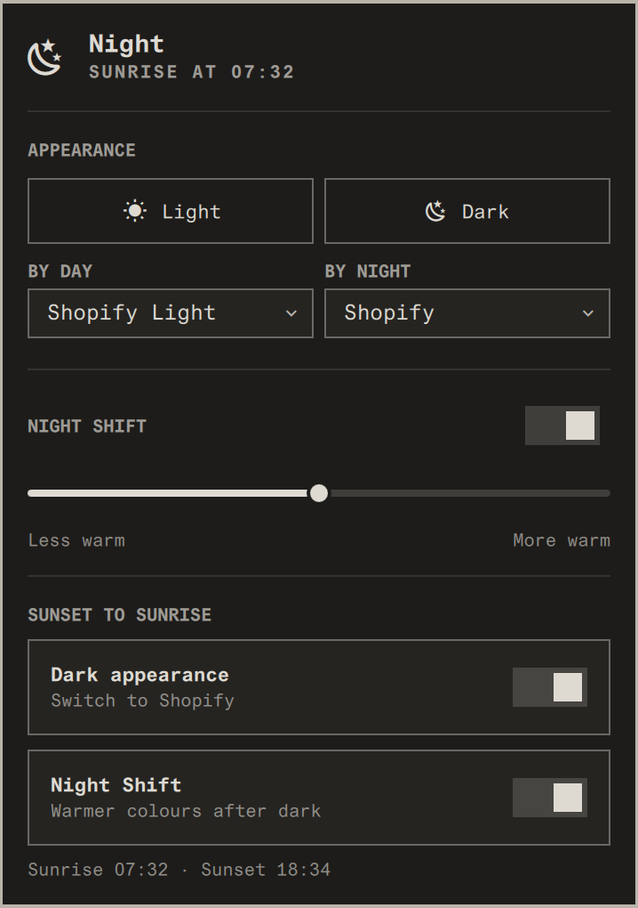

# Circadian

Your Omarchy desktop follows the day. Pick a theme for the day and one for the
night, and Circadian switches between them at sunrise and sunset. It also runs
Night Shift: warmer screen colours after dark, using hyprsunset like Omarchy's
Night Light.



## Install

```bash
omarchy plugin add https://github.com/benjaminsehl/circadian --enable
~/.config/omarchy/plugins/io.github.benjaminsehl.circadian/install.sh
```

The second line is optional. It moves Circadian to just before the bar's
indicators and hides Omarchy's Night Light indicator, since Circadian takes its
place. `uninstall.sh` next to it brings the indicator back. Update with
`omarchy plugin update io.github.benjaminsehl.circadian`.

To work on Circadian, clone it and run `./install.sh`. That links the clone
into `~/.config/omarchy/plugins/` instead of copying it. After editing QML, run
`omarchy restart shell`, because the shell can keep a cached copy.

Needs a recent Omarchy (the Quickshell-based shell), plus `hyprsunset`, `jq`
and `curl`, which Omarchy already ships.

On first run Circadian pairs your current theme with an obvious sibling if
there is one (`catppuccin` ↔ `catppuccin-latte`, `x` ↔ `x-light`). Otherwise
choose the themes in the popover.

## Use

The bar shows what you're looking at: a sun or a moon. It turns warm while
Night Shift is on. Click it for the popover:

- **Light / Dark**: switch now. With the schedule on, your choice holds until
  the next sunrise or sunset, and then the sun takes over again.
- **By day / By night**: the two themes. The lists show light themes and dark
  themes respectively.
- **Night Shift**: on/off now, and how warm.
- **Sunset to sunrise**: whether appearance and Night Shift follow the sun.
  When a switch is off, that setting stays wherever you put it.

Changes made elsewhere still count. If you pick one of the two themes in
Omarchy's theme switcher, or run `omarchy toggle nightlight` (or use its
keybinding), Circadian treats it as a manual choice. If you pick any other
theme, Circadian leaves appearance alone until you choose Light or Dark again.

Sunrise and sunset times come from wttr.in once a day, for the location set in
Omarchy's weather widget (or your IP address if none is set). If the lookup
fails, the last known times are used, or 07:00/19:00 if it has never succeeded.

## Command line

```bash
bin/circadian                         # status
bin/circadian appearance toggle       # or light | dark
bin/circadian nightshift toggle       # or on | off
bin/circadian set warmth 3500         # kelvin, 2500–5500
bin/circadian set darkTheme tokyo-night
bin/circadian set darkAtNight off     # nightShiftAtNight too
```

Omarchy's own Night Light keybinding (Super+Ctrl+N) keeps working, and
Circadian treats it as a manual Night Shift change. For a light/dark key,
bind the running shell directly in `~/.config/hypr/bindings.lua`. Pick a free
combination:

```lua
o.bind("SUPER + CTRL + ALT + L", "Toggle light/dark", "omarchy-shell circadian toggleAppearance")
```

## Files

- `bin/circadian`: the engine. All state and decisions live here, and the
  shell only displays them.
- `Service.qml`: one instance per shell. It runs `apply` every minute, watches
  for theme and config changes, and queues clicks so none are lost.
- `BarWidget.qml`: the icon and popover.
- `~/.config/circadian/config.json`: settings. `~/.local/state/circadian/`:
  overrides. `~/.cache/circadian/`: sunrise/sunset times.

`tests/engine-test.sh` runs the engine against stubbed Omarchy and hyprsunset
commands in a throwaway home directory.
